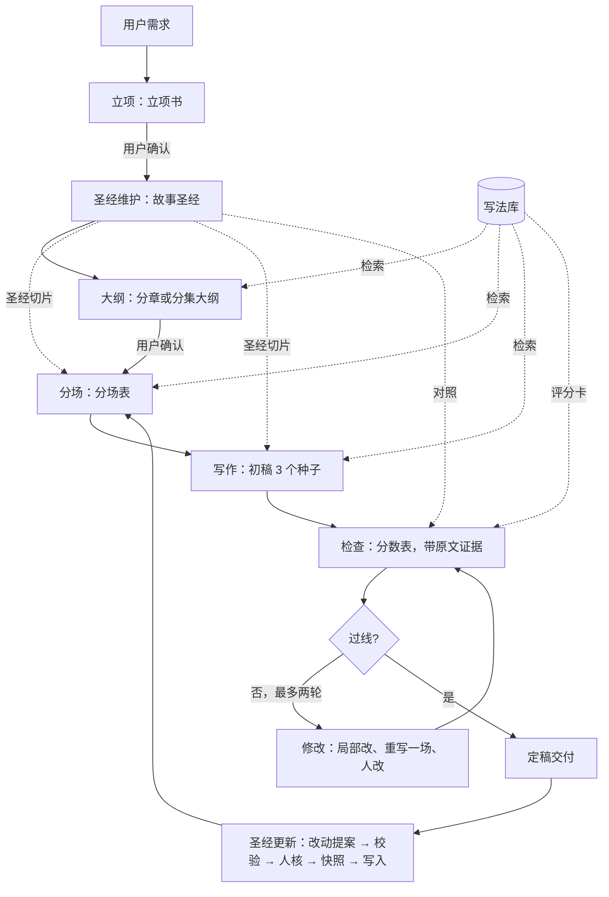

# 要件定义书

AI_Story_Studio ｜ 本地大模型剧本、小说写作系统

| 项目 | 内容 |
|---|---|
| 文档名 | 要件定义书 |
| 系统名 | AI_Story_Studio |
| 版本 | 1.3（确认版） |
| 编写日期 | 2026-11-18 |
| 编写者 | 要件定义担当 |
| 用途 | 企业开发流程的前期测试项目（要件定义工程） |

本书是本项目的第一份正式文档，后续基本设计书（02）、详细设计书（03）、测试规格书（04–07）、追溯矩阵（08）都以这里的 FR、NFR 编号为起点。
本书的输入素材是项目前期写的两份设计稿，内容已按要件书的格式重写；两份设计稿本身不算正式文档，不放进仓库。

---

## 1. 修订履历

| 版本 | 日期 | 内容 | 担当 |
|---|---|---|---|
| 0.1 | 2026-11-18 | 初稿 | 要件定义担当 |
| 0.2 | 2026-11-18 | 用户同意拆卡片等批量文字活可用 GPT，模型改成可切换的配置项（FR-50、FR-51，NFR-01、NFR-02、NFR-06、NFR-16）；加入藏书作数据来源（FR-43～FR-49，NFR-17、NFR-18） | 要件定义担当 |
| 0.3 | 2026-11-18 | 用户定「可以，就先试拆这三本」；藏书试拆改成技术验证（PoC），和正式实现分开（2.4 节、FR-49） | 要件定义担当 |
| 1.0 | 2026-11-18 | 用户确认：整份通过，Q-01～Q-11 全部照建议定（第 12 节） | 要件定义担当 |
| 1.1 | 2026-11-18 | 用户 11-18 确认后的变更。原因：用户说「集魂是 ai 写的小说 我并不觉得它写的很好」，定《集魂》只当「要改好的对照组」。改动：《集魂》不进写法库、不当正例（FR-52）；质量标杆改用藏书；效果验证改成「改写前、改写后、藏书同类场面」三方盲评（FR-40～FR-42、AC-06、G-04）；圣经导入《集魂》只用来测流水线能不能跑通（2.3 节、FR-15、AC-04 的说明） | 要件定义担当 |
| 1.2 | 2026-11-18 | 用户确认：剧本线补三样。节拍表卡，大纲先套节拍表（FR-53、FR-54）；可拍性检查，对照固定做法速查表，速查表能导入新版（FR-55、FR-56）；剧本定稿前的 TTS 围读（FR-57、FR-58）。相应改了 O-01、NFR-06，加了 UC-10、C-11、AC-10～AC-12 | 要件定义担当 |
| 1.3 | 2026-11-18 | 用户确认的设计变更。①检索精度：场面类型词表、卡片「什么时候用」、查之前改写需求、AI 重挑、标准答案考题、卡片效果记录、补标签（FR-59～FR-65）；规模改按几千张卡重估（NFR-04 改、NFR-19 新增）。②题材分类：按行业分类做《题材分类标准》（频道 → 大类 → 标签）、分类技能、31 本试分类，写法库题材栏改用这套词表（FR-66～FR-70）。③藏书：用户「GPT 的 token 还有很多 根本用不完，可以把书都试拆」，31 本全部拆（FR-49 改、FR-71 新增）。相应加了 UC-11、UC-12、AC-13～AC-16、Q-12～Q-15 | 要件定义担当 |
| 1.3 | 2026-11-18 | 用户确认 1.3 照建议通过（聊天），确认时改两处：① 藏书拆卡改成多本一起排队并行拆，登记和清洗记录拆完再补（FR-49、FR-71）；② 卡片「题材」栏改名「适用题材」，来源书的题材从分类表按书带入（FR-03、FR-45、FR-48、FR-69）。Q-12～Q-15 照建议定 | 要件定义担当 |

---

## 2. 本书的定位、目的、适用范围

### 2.1 定位

AI_Story_Studio 是一套跑在局域网推理服务器上的写作辅助系统。本书定义它「要做什么」和「做到什么程度算合格」，不定义「怎么做」（那是 02、03 的事）。

### 2.2 目的

1. 把用户的需求写成可以验收的条目（FR、NFR），每条都有编号、依据和验收方法。
2. 划清范围内和范围外，避免后续工程扩大或遗漏。
3. 列出要用户确认的事项，确认以后再进基本设计。

### 2.3 适用范围

适用于 AI_Story_Studio 第一版（v1）。第一版的对象作品：长篇小说一部（《集魂》），短剧剧本一部（天气预报第 2 集）。只产出文字，不产出图像、视频、声音。

《集魂》是前期由 AI 写的小说，用户认为写得不好，只当「要改好的对照组」：用它测流水线能不能跑通、改写后提升了多少，**不代表质量标准**，也不进写法库。「好」的标杆是藏书。
用户提供的藏书（31 本）作为写法库和圣经样板的数据来源，第一版先试拆 3 本。

### 2.4 技术验证（PoC）

藏书试拆按技术验证做，和正式实现分开：

- 目的：定卡片格式、拆法和 GPT 用量，结果写回本书和基本设计；
- 做法：三本统一转 UTF-8，每本只拆前 5 章左右，量每章的用量和用时，再估全本和 31 本全量；
- PoC 的程序不进正式实现，正式实现在详细设计以后另写；
- 结果写成 `docs/PoC_藏书试拆_1118.md`。

---

## 3. 用语定义

| 用语 | 定义 |
|---|---|
| 写法库 | 跨作品通用的写作方法库。由一张张「卡片」组成，存规矩、技法、节奏、骨架、模板、评分项。不存某部作品的具体事实 |
| 卡片 | 写法库的最小单位，一张只讲一件事，带出处（来源文件和行号） |
| 规矩卡 | 必须遵守的写法，违反就算错 |
| 技法卡 | 一种写法：怎么做、为什么有效、正例和反例 |
| 节奏卡 | 某部参考片量出来的数字，例如说话占比、镜头中位时长、第几秒开口 |
| 骨架卡 | 一集、一场或一段的节拍结构，从拉片得来 |
| 模板卡 | 人物卡、状态表、剧本格式、写作单这类空表 |
| 评分卡 | 一条可以打分的检查项，写清几分对应什么 |
| 故事圣经 | 一部作品的事实总账：前提、人物、设定、伏笔、事件、关系、人物现状、称呼 |
| 圣经切片 | 只取本单元用得到的那部分圣经，交给写作角色 |
| 单元 | 写作和更新圣经的最小单位。小说是一章，剧本是一集或一场 |
| 锁定事实 | 用户确认过的设定。AI 只能提议修改，不能直接改 |
| 流水线 | 立项、圣经维护、大纲、分场、写作、检查、修改七个角色按顺序接力的工作方式 |
| 冷读 | 只给正文、不给任何背景资料，让读者挑毛病的审稿方式 |
| 种子 | 同一份提示用不同随机数各写一稿，用来挑最好的一份 |
| DRY | 本地推理服务的一种防重复采样参数。长篇实测能防止后几章整段抄前文 |
| 推理服务器 | 局域网内一台带 96GB 显存显卡的机器，跑本地大模型，和图像、视频生成作业共用（下称「服务器」） |
| 写作模型 | 服务器上的 Qwen3.8 27B（Q8 量化，上下文 262K） |
| 向量模型 | 服务器上的 bge-m3（1024 维，多语言） |
| GPT（Codex） | 用户订阅的 GPT，经服务器上现有的 Codex 命令行调用，不走付费接口。不占显卡，但有额度上限 |
| 模型配置 | 每个角色用哪个模型（本地写作模型或 GPT）写在配置文件里，改配置就能切换，不改程序 |
| 藏书 | 用户提供的小说全文文件，31 本、约 42MB、10 位作者，主要是耽美，另有金庸武侠。只放本机和服务器 |
| 题材 | 卡片和作品的类型标签，例如传奇、武侠、耽美、悬疑、刑侦、天气、生活 |

---

## 4. 业务背景和目标

### 4.1 背景

工作室用 AI 做短剧和长篇小说，前期遇到这些问题：

| 编号 | 问题 | 来源 |
|---|---|---|
| P-01 | 台词不像真人说话：人设硬塞进对白、文字游戏观众听不懂 | 用户反馈（11-11） |
| P-02 | 写法规矩散在几十份文档和记录里，每次写作靠人记得去翻，常漏 | 前期调查 |
| P-03 | 长篇连载里人物外貌、称呼、关系前后对不上；伏笔埋了不收 | 小说试写实测 |
| P-04 | 本地模型连写多章，后几章会整段抄前文 | 小说试写实测（不开 DRY 时 3 个种子中 2 个崩） |
| P-05 | 剧本节奏达不到参考片：说话占比低、开口晚、空镜多 | 剪辑复盘实测 |
| P-06 | 做得好不好要靠用户亲自看，没有能自己打分、自己改的手段 | 用户反馈（11-16）：「我需要你有自己完善自己的能力」 |

### 4.2 目标

用户 11-18 原话：「我们就按标准的来构建」，要建全四个部件：分工智能体流水线、故事圣经、检索库、检查修改。目标是把剧本和小说都写好。

| 编号 | 目标 | 怎么算达到 |
|---|---|---|
| G-01 | 写作前自动带上相关的写法规矩和技法 | 每份稿子都能列出用了哪些卡片 |
| G-02 | 长篇前后一致 | 圣经对照项的违反次数比不用圣经时少 |
| G-03 | 稿子能自己打分、自己改 | 每份稿子附分数表，每项扣分都有原文证据 |
| G-04 | 证明这套做法有用 | 小说：《集魂》的一章用新流水线重写后，盲评胜过改写前，并量出和藏书同类场面还差多少；剧本：走流水线的稿子胜过不走的（见第 11 章 AC-06） |

---

## 5. 范围

### 5.1 范围内

| 编号 | 内容 |
|---|---|
| S-01 | 写法库：从指定来源拆卡片、校验、去重、入库、检索 |
| S-02 | 故事圣经：建立、按单元更新、校验、快照和回滚 |
| S-03 | 流水线：七个角色（剧本线加分镜，小说转剧本加改编）的串联和断点续跑 |
| S-04 | 检查修改：剧本、小说两张评分表，机器检查，对照检查，冷读，分级修改 |
| S-05 | 效果验证：小说三方盲评（改写前、改写后、藏书同类场面），剧本三组对照，出对比报告 |
| S-06 | 正式文档 01–09 和测试 |
| S-07 | 藏书：统一转码、按题材标注、试拆 3 本（《默读》《射雕英雄传》《破云》）成卡片和圣经样板、额度估算 |

### 5.2 范围外

| 编号 | 内容 | 理由 |
|---|---|---|
| O-01 | 出图、出片、配音、剪辑 | 第一版只出文字。TTS 围读（FR-57）的音频只用来检查台词，不当交付物 |
| O-02 | 付费云端模型接口（按用量计费的 API） | 成本要求；订阅制的 GPT 不在此列，见 NFR-01 |
| O-03 | 常驻网页服务、对外接口 | 不新起服务（NFR-03）；以后要做先问用户 |
| O-04 | 把小说原文、外部作品原文、原片台词存进库 | 版权和数据要求（NFR-12） |
| O-05 | 多用户权限管理、登录 | 只在工作室内部使用 |
| O-06 | 自动发布作品 | 发布由用户决定 |
| O-07 | 藏书全量拆卡 | 先试拆 3 本，全量拆不拆等试拆结果出来再定（Q-08） |

---

## 6. 角色和用例

### 6.1 角色

| 编号 | 角色 | 说明 |
|---|---|---|
| A-01 | 用户（作者、决策者） | 确认立项书和大纲，确认锁定事实，看对比结果 |
| A-02 | 总督导 | 分派工作、排显卡；小说定稿的人工改写；批准对锁定事实的改动 |
| A-03 | 运营担当（剧本与剪辑） | 跑流水线、核对圣经改动提案、改剧本、维护剧本类卡片 |
| A-04 | 卡片维护者（声音、审美、模型学习、传奇知识各频道） | 各自维护自己那类卡片 |
| A-05 | GPT（Codex，订阅，经用户同意） | 做拆卡片、冷读这类批量文字活；写作、检查、修改不交给它 |
| A-06 | 写作模型、向量模型 | 系统内部调用的本地模型 |

### 6.2 用例

| 编号 | 用例 | 主要角色 | 对应要件 |
|---|---|---|---|
| UC-01 | 建立和更新写法库 | A-03、A-04 | FR-01～FR-10、FR-52 |
| UC-02 | 写作前检索写法 | A-03 | FR-11～FR-13 |
| UC-03 | 立项和建立故事圣经 | A-01、A-03 | FR-14～FR-16、FR-23 |
| UC-04 | 写一个单元（大纲 → 分场 → 写作） | A-03 | FR-22～FR-29 |
| UC-05 | 检查和修改一份稿子 | A-03、A-05、A-02 | FR-30～FR-39 |
| UC-06 | 定稿后更新圣经 | A-03、A-02 | FR-17～FR-21 |
| UC-07 | 跑效果验证、出对比报告 | A-03、A-01 | FR-40～FR-42 |
| UC-08 | 藏书试拆 | A-03、A-05 | FR-43～FR-49 |
| UC-09 | 切换某个角色用的模型 | A-03 | FR-50、FR-51 |
| UC-10 | 剧本定稿前：可拍性检查、TTS 围读，查出的问题打回改写 | A-03 | FR-55～FR-58 |
| UC-11 | 写作前查卡：改写需求 → 两路检索 → AI 重挑 → 带理由交写作角色 | A-03 | FR-59～FR-64 |
| UC-12 | 给一本书分类（频道、大类、标签），拿不准的交用户定 | A-03、A-01 | FR-66～FR-68 |

### 6.3 业务流程

---

## 7. 功能要件（FR）

优先级：必须＝第一版一定要有；应该＝第一版尽量有，没有要说明理由。

### 7.1 写法库

| 编号 | 要件 | 优先级 | 验收方法 |
|---|---|---|---|
| FR-01 | 能从来源清单里的文件把写作方法拆成卡片。来源包括：剧本写作技能原版和工作室补充规矩、拉片笔记、节奏标准、台词规矩、人物模板、写法规矩记录、写小说技能 | 必须 | 跑一次，来源清单里每份文件都有处理记录 |
| FR-02 | 卡片分 6 种：规矩、技法、节奏、骨架、模板、评分 | 必须 | 库里每张卡的种类都属于这 6 种 |
| FR-03 | 每张卡有固定的栏：编号、标题、种类、阶段、体裁、适用题材、来源题材、做法、为什么、正例、反例、数字、出处、硬度、状态、来源级别、关联、维护者 | 必须 | 格式校验全部通过 |
| FR-04 | 英文来源抽成中文卡 | 必须 | 抽查英文来源的卡，正文是中文 |
| FR-05 | 卡片不收小说原文、外部作品原文、原片台词和剧情复述；正例和反例用自己写的句子 | 必须 | 抽查 50 张，没有原文照搬 |
| FR-06 | 每张卡的出处能回查到原文件和行号；对不上的卡不入库，列给人核 | 必须 | 出处校验通过率 100%，没过的进待核清单 |
| FR-07 | 意思相同的卡合并：留来源级别高的那张，把其他出处并进来；近似的卡列出来给人看 | 必须 | 去重报告列出合并对和近似对 |
| FR-08 | 作废的规矩也入库，标「作废」，默认检索不出来 | 必须 | 默认检索结果里没有作废卡；加参数能查到 |
| FR-09 | 库能从卡片原文全量重建；重建时上一版留底 | 必须 | 删库后重建，卡片数和内容一致 |
| FR-10 | 每类卡只能由负责它的维护者修改，修改留记录 | 应该 | 改动记录里有维护者和日期 |
| FR-11 | 按阶段和体裁取出全部规矩卡、模板卡、评分卡，不排名、不截断 | 必须 | 结果数等于库里符合条件的卡数 |
| FR-12 | 用一段写作说明检索技法卡和骨架卡：向量检索和全文检索混合，合成名次后取前 k 张 | 必须 | 结合测试的检索准确率达到 NFR-04 |
| FR-13 | 结果冲突时按来源级别排：用户定、实测、补充规矩、原版技能、拉片 | 必须 | 测试数据里两张冲突卡，排在前面的是级别高的 |
| FR-52 | 《集魂》的章节、人物卡、大纲不进写法库，任何卡片都不能拿它当正例；写法库来源清单里有《集魂》资料的全部去掉 | 必须 | 来源清单和卡片的出处里没有《集魂》 |

### 7.2 故事圣经

| 编号 | 要件 | 优先级 | 验收方法 |
|---|---|---|---|
| FR-14 | 每部作品一套圣经，含前提、人物、设定、伏笔、事件时间线、关系表、人物现状、称呼表、改动记录 | 必须 | 新建作品后各部分都存在且格式正确 |
| FR-15 | 能导入《集魂》现有资料：人物卡（14 个字段）、分章大纲、伏笔记录、章节记录。导入只用来测流水线能不能跑通，《集魂》不代表质量标准 | 必须 | 导入后条数和原资料一致 |
| FR-16 | 用户确认过的事实标「锁定」 | 必须 | 锁定标记能读出来 |
| FR-17 | 每个单元定稿后，自动抽一份改动提案：新事件、新伏笔（最多 2 条）、收了哪些伏笔、人物状态变化、关系变化、新称呼 | 必须 | 用已有章节跑，提案格式正确 |
| FR-18 | 改动提案过代码校验：编号连续、新旧伏笔去重、状态数值在 0–100、关系一次只变一档（变两档要写原因）、改到锁定事实的单独挑出 | 必须 | 每条校验规则都有对应的单体测试 |
| FR-19 | 改动提案经人核以后才写入；写入前存快照，写入后记改动记录 | 必须 | 没有人核标记的提案写不进去 |
| FR-20 | 只允许重写最新一个单元，重写时用快照回滚 | 必须 | 回滚后圣经和快照一致；要求回滚更早的单元时报错 |
| FR-21 | 改到锁定事实的提案不能自动写入，要标出来交总督导问用户 | 必须 | 测试数据里改锁定事实的提案被拦下 |

### 7.3 流水线

| 编号 | 要件 | 优先级 | 验收方法 |
|---|---|---|---|
| FR-22 | 有七个角色：立项、圣经维护、大纲、分场、写作、检查、修改。剧本线在分场后多一步分镜；小说转剧本时多一个改编角色 | 必须 | 每个角色能单独运行，输入输出格式正确 |
| FR-23 | 立项书和大纲两处停下来，等用户确认后才继续；其余自动往下走 | 必须 | 没有确认标记时流水线停在这两步 |
| FR-24 | 每一步的产物都落成文件，断了能从任何一步接着跑 | 必须 | 中途停掉再续跑，结果和不停一样 |
| FR-25 | 写某个单元时只给用得到的圣经切片（在场人物、地点、相关伏笔、最近事件），拿不准时用向量补查 | 必须 | 切片里没有不在场的人物 |
| FR-26 | 写作每次出 3 个种子，先用机器检查挑出最好的一份 | 必须 | 产物里有 3 份初稿和挑选记录 |
| FR-27 | 用本地写作模型写小说正文时开 DRY；抽结构化信息时关 DRY、温度 0.2 | 必须 | 请求记录里的参数符合 |
| FR-28 | 大纲每个单元写「结尾时……」，并给后面 3 个单元列不能提前出现的词；剧本大纲先套节拍表（FR-54） | 必须 | 大纲格式校验通过 |
| FR-29 | 剧本分镜每镜写：景别、运镜编号、姿势从哪到哪、台词、画外和独白、开口时刻、场景锚定句 | 必须 | 分镜格式校验通过 |

### 7.4 检查和修改

| 编号 | 要件 | 优先级 | 验收方法 |
|---|---|---|---|
| FR-30 | 剧本、小说各一张评分表，满分 100，分机器项、对照项、读感项三类 | 必须 | 两张表都能对样稿打出分数 |
| FR-31 | 每项扣分都要附原文引文和位置；没有引文的扣分不算 | 必须 | 分数表里每个扣分项都有引文，引文能在原文里找到 |
| FR-32 | 机器项由代码量。剧本：说话占比、开口时间、无台词段长度、每镜有没有姿势、可拍性规矩。小说：跨章复用率、密度、套话、是否守大纲 | 必须 | 每个机器项都有单体测试 |
| FR-33 | 对照项拿圣经和规矩卡对照，由写作模型找证据 | 必须 | 测试稿里故意放的矛盾被找出 |
| FR-34 | 读感项由冷读者冷读两次，只给正文；两次都扣才算扣 | 必须 | 分数表里读感项有两次冷读的记录 |
| FR-35 | 任何一步调用 GPT 遇到额度用完或限流，就停下，不自动重试，提示操作者和预计恢复时间；恢复后从停下的地方续跑，已完成的不重做 | 必须 | 模拟限流时流程停下并留提示；续跑后不重复调用已完成的部分 |
| FR-36 | 修改分三档：局部改几句、重写一场、人改。局部改完由代码检查引号开合、字数、人名，不过就保留原句 | 必须 | 局部改的检查规则有单体测试 |
| FR-37 | 改完重新打分，分数只许升不许降，降了退回上一稿；最多改两轮，没过的项写进交付说明 | 必须 | 测试里分数下降时退回上一稿 |
| FR-38 | 评分表要过反向对照：故意放进错误的坏稿必须被扣分 | 必须 | 坏稿的每处错误都被对应项扣分 |
| FR-39 | 交付物包括定稿、分数表、用了哪些卡的清单 | 必须 | 交付目录里三样都在 |

### 7.5 效果验证

| 编号 | 要件 | 优先级 | 验收方法 |
|---|---|---|---|
| FR-40 | 能跑两类效果验证。小说：拿《集魂》的一章当「改写前」，用新流水线按同一章的大纲重写成「改写后」，再从藏书里找同类场面（例如初见、师徒、打斗）当「标杆」，三方一起盲评；至少做 3 题。剧本：天气预报第 2 集跑三组，A 不走流水线、B 只贴规矩清单、C 走流水线，同一模型、同一份写作单，每组 3 个种子 | 必须 | 实验目录里小说每题三方齐全；剧本三组各 3 份 |
| FR-41 | 读感项盲评：评的人不知道哪份是哪方；两两比较时调换先后顺序各评一次，两次一致才算数。藏书片段可能被认出来，三方一律把人名、地名换成代号，篇幅截到相近长度 | 必须 | 盲评记录里有两次顺序；送评文本里没有原作人名 |
| FR-42 | 出对比报告：机器指标、硬规矩违反次数、盲评结果、提升幅度（小说：改写后比改写前高多少，和标杆的差距缩小了几成），结论（有用、可以简化、无用） | 必须 | 报告格式校验通过 |

---

### 7.6 藏书

| 编号 | 要件 | 优先级 | 验收方法 |
|---|---|---|---|
| FR-43 | 入库前把藏书统一转成 UTF-8。原文件有 UTF-8、GBK、UTF-16LE 等多种编码，要自动识别；识别不了的列出来给人看，不猜 | 必须 | 3 本试拆书转码后字数和原文件一致，没有乱码 |
| FR-44 | 每本书登记：书名、作者、题材、字数、编码、有没有影视版 | 必须 | 登记表覆盖全部 31 本 |
| FR-45 | 从藏书拆出写法卡片（技法、骨架为主）。卡片标「适用题材」（这个写法能用在哪些题材）；「来源题材」（来源书的频道、大类、标签）从题材分类表（FR-68）按书带入，不让拆卡模型自己判 | 必须 | 每张卡的适用题材不为空；来源题材和分类表一致 |
| FR-46 | 从藏书拆出故事圣经样板：人物、关系、伏笔、事件时间线的结构，用来给 FR-14 的格式做参照 | 应该 | 试拆的书至少 1 本出完整样板 |
| FR-47 | 有影视版的书，可以标出「小说怎么改成剧本」的对照点（删了什么、合并了什么、改成什么画面），作为改编角色的技法卡 | 应该 | 试拆书里有影视版的，至少出 5 张改编卡 |
| FR-48 | 检索时能按题材筛选（例如只要武侠、或排除纯爱），可以按「适用题材」筛，也可以按「来源题材」筛 | 必须 | 加题材条件后结果里只有该题材和通用卡 |
| FR-49 | 藏书拆卡分两段。第一段：试拆 3 本（《默读》《射雕英雄传》《破云》，用户 11-18 定），按技术验证（2.4 节）先拆前 5 章实测用量。第二段：用户 11-18 定「可以把书都试拆」，31 本一起排队并行拆（FR-71），三本排在队首、先抽查质量 | 必须 | PoC 报告里有实测用量、估算用量、卡片数、抽查结果；全量拆完有总报告 |

### 7.7 模型配置

| 编号 | 要件 | 优先级 | 验收方法 |
|---|---|---|---|
| FR-50 | 每个角色（拆卡片、冷读、立项、圣经维护、大纲、分场、写作、检查、修改）用哪个模型，写在配置文件里，改配置就能切换。默认：拆卡片、冷读用 GPT；写作、检查、修改和其余角色用本地写作模型 | 必须 | 改配置后同一步换了模型，程序不用改 |
| FR-51 | 每次模型调用记一行：哪一步、哪个模型、用时、输入输出字数、成功还是被限流 | 必须 | 跑完能按模型汇总用量 |

### 7.8 剧本线补充（1.2 新增，用户 11-18 确认）

| 编号 | 要件 | 优先级 | 验收方法 |
|---|---|---|---|
| FR-53 | 写法库加「节拍表」卡（骨架卡的一类），至少有两种：整部作品的节拍（救猫咪式，从开场画面到结尾画面的 15 个节拍）；短剧的节拍（前 3 秒钩子、每 30–60 秒一个爽点、每集结尾留悬念）。每个节拍写清放在哪个位置、要完成什么 | 必须 | 写法库里两种节拍表卡都在，格式校验通过 |
| FR-54 | 写剧本大纲时，先选一张节拍表套上，再按节拍填内容；大纲里每个单元标出它对应哪个节拍。检查时核对节拍有没有缺、位置有没有偏 | 必须 | 大纲里每个单元都有节拍标记；缺节拍或位置偏出时检查报出来 |
| FR-55 | 可拍性检查：剧本定稿前，对照固定做法速查表，逐镜查出现有视频模型拍不了或拍不好的写法，至少包括长距离走动、两只手都占着、多人同时开口、心理活动、画面上看不见的东西。查出的每处写明镜号、原句、违反哪条、依据速查表哪一节，打回改写 | 必须 | 测试剧本里故意放的每类问题都被查出，打回记录齐全 |
| FR-56 | 可拍性规则从速查表导入，存成带版本号的规则集；速查表更新后能重新导入，新旧版本能对比，检查报告写明用的是哪一版 | 必须 | 导入两版速查表，规则集版本号不同，报告里写明版本 |
| FR-57 | TTS 围读：剧本定稿前，用声音频道的固定做法（配音 E）把全部台词念一遍，量每句的时长 | 必须 | 每句台词都有音频时长记录 |
| FR-58 | 围读后挑出三类句子：拗口（念出来再转写回文字，和原句对不上，或者语速明显慢）、太长（单句时长超过节奏卡的上限）、像念稿（书面语、长定语、没有口语停顿）。挑出的句子写明原因，打回改写 | 必须 | 测试台词里故意放的三类句子都被挑出 |

### 7.9 检索精度（1.3 新增，用户 11-18 确认）

| 编号 | 要件 | 优先级 | 验收方法 |
|---|---|---|---|
| FR-59 | 场面类型固定词表，例如重逢、对峙、告白、反转、立誓、背叛、收伏笔。每张卡标一个或多个场面类型。词表是一张受管理的表（FR-70） | 必须 | 卡片的场面类型都在词表内 |
| FR-60 | 卡片加一栏「什么时候用」：一句话写清触发条件。向量检索主要拿这一句去比，不比整张卡 | 必须 | 每张卡都有这一栏；检索用的向量来自这一栏 |
| FR-61 | 查之前先改写需求：写作这一步先把场景改写成和卡片同一套词的标准需求，栏目为阶段、体裁、题材、场面类型、要表现什么、有什么限制，再拿去查 | 必须 | 每次检索的记录里有改写后的标准需求 |
| FR-62 | AI 重挑：两路检索合并后取前 30 张，由模型挑出 5–8 张，每张写明为什么选。重挑用哪个模型可配置，默认本地写作模型，可切 GPT。专门的重排模型（bge-reranker）是备选，装之前问用户 | 必须 | 重挑结果每张有理由；改配置能换模型 |
| FR-63 | 标准答案考题：50 个写作需求，每个由人标出该找到的卡，算前 8 张命中率。每次调整检索（词表、提示、权重、模型）都重考一遍，结果留档 | 必须 | 考试记录里有每次的命中率和调整内容 |
| FR-64 | 卡片效果记录：每张卡被用过以后，那份稿子的分数涨没涨记下来；多次用了都没涨的卡在重挑前往后排 | 应该 | 卡片有使用次数和分数变化；排序受它影响 |
| FR-65 | 补标签程序：给已有卡片补「场面类型」和「什么时候用」两栏，默认用 GPT；补完过格式校验，抽查 | 必须 | 已有卡全部补齐 |

### 7.10 题材分类（1.3 新增，用户 11-18 确认）

| 编号 | 要件 | 优先级 | 验收方法 |
|---|---|---|---|
| FR-66 | 写一份《题材分类标准》，放 docs/。依据网络文学主要平台（起点中文网、晋江文学城、番茄小说、七猫小说）近一年的分类，写清出处。三层：频道（男频、女频、纯爱/耽美的归法）→ 大类（如玄幻、仙侠、都市、历史、悬疑、古言、现言、幻言、纯爱）→ 标签（如重生、穿越、无限流、刑侦、娱乐圈）；每类写判别规则（主角性别和视角、主线是升级还是感情、目标读者）、正例、容易混淆的例子、拿不准时怎么处理 | 必须 | 文档在仓库；每条依据有出处和日期 |
| FR-67 | 分类技能：AI 按这套标准给一本书分类（频道、大类、标签），写出分类依据，依据必须是书里看得到的东西（如主角性别、开篇情节、主线），并给把握程度 | 必须 | 每本书的分类都有依据和把握程度 |
| FR-68 | 先拿 31 本藏书试分类，出一张表：书名、频道、大类、标签、依据、把握程度；拿不准的标出来交用户定 | 必须 | 表格覆盖 31 本 |
| FR-69 | 写法库的「适用题材」「来源题材」两栏都用这套词表，拆卡和补标签都按它来；之前按临时词表标的卡，用补标签程序（FR-65）改过来 | 必须 | 卡片题材全部在新词表内 |
| FR-70 | 受管理的词表：题材词表、场面类型词表各存一张表，带版本号；加词、改词要留记录（日期、谁、为什么）；卡片和书引用词表时记版本 | 必须 | 词表有版本和改动记录 |
| FR-71 | 藏书全量拆的流程：多本书一起排队并行拆（用户 11-18 定 10 路，三本抽查合格后 20 路）；登记（书名、作者、题材、字数、编码、有没有影视版）和清洗记录拆完再补；每 5 本回报一次累计卡片数、按种类和题材分的数量、定位回查通过率，抽 3 张卡；全部拆完做一次全库去重，再出总报告 | 必须 | 回报和总报告齐全；31 本都有登记 |

## 8. 非功能要件（NFR）

| 编号 | 分类 | 要件 | 验收方法 |
|---|---|---|---|
| NFR-01 | 成本 | 不用按用量计费的付费接口。写作、检查、修改优先用服务器上的本地写作模型；拆卡片、冷读这类批量文字活可以用 GPT（Codex，订阅，经服务器上现有方式调用）。用哪个由配置决定（FR-50） | 代码里没有付费接口的调用；GPT 调用只出现在配置允许的步骤 |
| NFR-02 | 成本 | GPT 额度到了就停，不重试，避免额度被重复消耗；恢复后能续跑。批量任务开跑前先估用量 | 同 FR-35、FR-49 |
| NFR-03 | 资源 | 不新起常驻服务、不占新端口。所有程序跑完就退；以后要起服务，先问用户 | 跑完后服务器上没有本系统的常驻进程 |
| NFR-04 | 性能 | 规模按几千张卡算（31 本拆完约 6000 张，留余量按 1 万张设计）。两路检索（向量、全文）合计 1 秒内（不含模型冷启动和 AI 重挑）；AI 重挑另计，一次在 60 秒内。实测：8000 张卡、1024 维向量，从库里读出全部向量 0.04 秒，逐张算余弦并排序 0.003 秒，直接全算仍够用，不建向量索引 | 结合测试计时 |
| NFR-05 | 性能 | 写作模型并发不超过 4 路（服务器推理服务的设定） | 代码里的并发上限 |
| NFR-06 | 可用性 | 和图像、视频生成作业共用一张显卡：起本地写作模型或 TTS 围读前先查显存，空闲不够就等，不抢别人的作业；用完卸载。走 GPT 的步骤不占显卡，可以在显卡忙时先跑 | 运行记录里有显存检查；GPT 步骤不触发显存检查 |
| NFR-07 | 可用性 | 中途断掉能接着跑，已完成的步骤不重做 | 同 FR-24 |
| NFR-08 | 安全 | 仓库公开：不放密码、令牌、密钥和个人信息；服务器地址只写在本地 `.env` 里，不进仓库；`.env` 和凭证文件排除在版本管理之外 | 推送前扫描；`.gitignore` 生效 |
| NFR-09 | 安全 | 不改用户已定事实；交出去的文件不原名覆盖，改了另存新版 | 同 FR-21；文件命名带版本 |
| NFR-10 | 可维护性 | 卡片原文一张一个文件，能直接读、直接改、看得出改了什么；库文件能从原文重建 | 同 FR-09 |
| NFR-11 | 可维护性 | 只用 Python 标准库、numpy 和 SQLite（全文检索用 FTS5 trigram），不新装第三方包 | 依赖清单检查 |
| NFR-12 | 数据 | 不存小说原文、外部作品原文、原片台词；仓库里引用外部作品只写摘要 | 推送前扫描 |
| NFR-13 | 可追溯 | 每张卡能回到原文件和行号；每份稿子能列出用了哪些卡；圣经每次改动有记录和快照 | 同 FR-06、FR-19、FR-39 |
| NFR-14 | 质量 | 测试必须真跑，结果以测试工具的输出为准，不许编 | 测试结果附原始输出 |
| NFR-15 | 语言 | 卡片、圣经、报告、正式文档用简体中文 | 语言检查脚本通过 |
| NFR-16 | 可维护性 | 模型是可以切换的配置项：本地写作模型和 GPT 用同一个调用接口，换模型只改配置 | 同 FR-50 |
| NFR-17 | 数据 | 藏书原文只放本机和服务器，不进公开仓库。卡片里不整段引用原文，只写摘要和结构；单处引用不超过一句 | 推送前扫描仓库里没有藏书文件；抽查卡片没有整段原文 |
| NFR-18 | 数据 | 入库的文字一律 UTF-8 | 同 FR-43 |
| NFR-19 | 可维护性 | 检索质量可度量：任何检索调整都要重考 50 题，命中率不得低于上一次（降了要说明原因并经确认） | 考试记录 |

---

## 9. 制约和前提

| 编号 | 内容 |
|---|---|
| C-01 | 服务器：AMD Ryzen 9 9950X、内存 96GB、显卡 NVIDIA RTX PRO 6000（显存 96GB）、Ubuntu 24.04。显卡同时给图像、视频生成和别的项目用 |
| C-02 | 写作模型由服务器上已有的推理服务提供（OpenAI 兼容接口），上下文 262K，4 路并发；向量模型由已有的 Ollama 提供。本系统只调用，不管理这些服务 |
| C-03 | 写作模型常驻时约占 37GB 显存，图像、视频作业整卡峰值可到 77–80GB，两者放不到一起，要排队 |
| C-04 | 写作模型只出初稿，不做整篇改写。前期实测让它改写已有稿子，会丢句、串戏、出错字 |
| C-05 | DRY 只在长篇里有用；写长篇必开，抽 JSON 必关 |
| C-06 | 现有的小说检查脚本（复用率、密度、并段）照原样调用，不改 |
| C-07 | GPT 只做拆卡片、冷读这类批量文字活，写作、检查、修改不交给它（用户 11-18 同意） |
| C-09 | GPT 订阅的额度上限没有公开数字，只能实测。前期出图时 5 小时窗口曾被用满 |
| C-10 | 试拆 3 本的规模：《默读》约 86 万字（GBK）、《破云》约 98 万字（UTF-16）、《射雕英雄传》约 99 万字（UTF-8），共约 283 万字。按每块 8000 字切约 360 块，粗估输入 300–400 万 token、输出约 50 万 token，要实测 |
| C-11 | 可拍性的依据是工作室的固定做法速查表，它记的是现有视频模型实测拍不了或拍不好的写法，会随实测更新。TTS 围读用声音频道的固定做法（IndexTTS-2.5 克隆配音，后期按「E 版」），要占显卡 |
| C-12 | 网络文学平台的分类各家不同，而且会调整；本系统的分类以《题材分类标准》为准，标准写明依据的是哪几家平台、哪个时间点的分类 |
| C-08 | 运行环境用服务器上现有的 Python 3.12 虚拟环境，含 numpy；SQLite 3.45.1 |

---

## 10. 输入素材

| 素材 | 用途 |
|---|---|
| 前期设计稿两份（AI 写作系统总设计、剧本写法库设计） | 本书内容的来源，不进仓库 |
| 写法库来源约 148 份 | FR-01 的输入。仓库只放来源清单和处理程序，来源原文不放（含外部作品摘录的不公开） |
| 《集魂》人物卡、大纲、伏笔、章节记录 | FR-15 的输入（只测流水线跑通）和 FR-40 的「改写前」。不进写法库（FR-52），不公开（Q-03） |
| 前期原型程序（抽卡、组装、检索） | 只当参考，详细设计以后按正式流程重写 |
| 藏书 31 本 | FR-43～FR-49 的输入。原文只放本机和服务器（NFR-17） |

---

## 11. 验收标准

| 编号 | 标准 | 对应 |
|---|---|---|
| AC-01 | 所有「必须」的 FR 都有对应的设计（02、03）、测试用例（04、06）和通过的测试结果（05、07），追溯矩阵（08）里没有断链 | 全部 FR |
| AC-02 | 单体测试、结合测试全部真跑，通过率 100%；没通过的写进品质总结（09）并说明原因 | NFR-14 |
| AC-03 | 写法库建好：卡片数、各种类张数、出处校验通过率、去重结果都有记录；抽 5 次检索人工判相关性，达到 NFR-04 | FR-01～FR-13 |
| AC-04 | 《集魂》圣经导入成功，用已有一章跑通「抽提案 → 校验 → 人核 → 写入 → 回滚」（只验流程，不验质量） | FR-14～FR-21 |
| AC-05 | 评分表过反向对照：坏稿里每处故意放的错误都被扣分 | FR-38 |
| AC-06 | 小说：3 题里至少 2 题「改写后」盲评胜过「改写前」，硬规矩违反次数少一半以上；和藏书标杆的差距缩小了几成照实写，不设过线。剧本：C 组比 A 组在 3 个种子的比较里至少赢 2 次，硬规矩违反次数少一半以上；C 组和 B 组差不多时，结论写「可以简化」，不算失败 | FR-40～FR-42 |
| AC-07 | 推送前扫描：仓库里没有密码、令牌、个人信息、外部作品原文、藏书文件 | NFR-08、NFR-12、NFR-17 |
| AC-08 | 藏书试拆：3 本转码无乱码；出卡数、各题材张数、GPT 实测用量都有记录；抽查 30 张卡没有整段原文 | FR-43～FR-49 |
| AC-10 | 节拍表：写法库里有整部节拍和短剧节拍两类节拍表卡；用天气预报第 2 集跑一次大纲，大纲里每个节拍都对上了节拍表 | FR-53、FR-54 |
| AC-11 | 可拍性：准备一份故意写了拍不了的写法（长距离走动、两只手都占着、多人同时开口、心理活动、看不见的东西）的测试剧本，每处都被查出并打回；换一版速查表导入后，新加的规则生效 | FR-55、FR-56 |
| AC-12 | TTS 围读：天气预报第 2 集的台词全部念完，每句有时长；故意放进的拗口句、超长句、书面腔句被挑出来 | FR-57、FR-58 |
| AC-13 | 检索考题：50 题人工标注，算前 8 张命中率；记录首次考试的基线，之后每次调整检索都重考，命中率不低于上一次 | FR-63 |
| AC-14 | 补标签：已有卡片全部补上「场面类型」和「什么时候用」，抽查 30 张合格 | FR-59、FR-60、FR-65 |
| AC-15 | 题材分类：31 本都有频道、大类、标签、依据、把握程度；拿不准的列给用户；写法库题材栏全部换成新词表 | FR-66～FR-70 |
| AC-16 | 31 本全量拆完：每本有登记；全库去重后出总报告（卡片数、按种类和题材分的数量、定位回查通过率、抽查结果） | FR-49、FR-71 |
| AC-09 | 模型切换：把同一步从本地模型切到 GPT 再切回来，结果格式一致，调用记录分得清 | FR-50、FR-51 |

---

## 12. 要用户确认的事项

| 编号 | 事项 | 建议 | 结论 |
|---|---|---|---|
| Q-01 | 第一版范围：四个部件全做完再交，还是先交写法库和圣经？ | 四个部件全做（用户 11-18 定的是全四样），但按 02 → 09 的工程顺序一次走完 | 用户 11-18 确认：照建议 |
| Q-02 | 结合测试里的模型调用：真调写作模型，还是用录好的回答？ | 两种都要：日常回归用录好的回答（不占卡、可重复），验收时真调一次 | 用户 11-18 确认：照建议 |
| Q-03 | 《集魂》的人物卡、大纲公开到仓库吗？ | 仓库只放格式样例和一份脱敏的示例作品；《集魂》真实资料放服务器，不公开 | 用户 11-18 确认：照建议 |
| Q-04 | 写法库卡片公开到仓库吗？卡片里有工作室的规矩和用户原话 | 公开格式和程序；卡片本身放服务器，不公开 | 用户 11-18 确认：照建议 |
| Q-05 | 对照实验的题目：小说用《集魂》一章，剧本用天气预报第 2 集，确认吗？ | 照用户 11-18 定的 | 用户 11-18 确认：照建议。1.1 变更：《集魂》改当「改写前」对照组，标杆用藏书（FR-40） |
| Q-06 | 评分表各项的分值，先拿两三份已有稿子试打再调，调好给用户看 | 照用户 11-18 定的 | 用户 11-18 确认：照建议 |
| Q-07 | 本系统交付物的保存位置：服务器 `/mnt/storage/ai-writing/`，本机留同步副本 | 照用户 11-18 定的 | 用户 11-18 确认：照建议 |
| Q-08 | 藏书全量拆不拆 | 等试拆 3 本的结果再定 | 用户 11-18 确认：照建议 |
| Q-09 | 试拆的用量：3 本粗估输入 300–400 万 token，会不会超出 GPT 额度？ | 先拆 1 本（《射雕英雄传》，UTF-8 最省事）实测用量，再定另两本；额度紧就改成只拆关键章节（开头、人物初登场、高潮、结尾） | 用户 11-18 确认：照建议 |
| Q-10 | 学「小说怎么改成剧本」要对照影视版，但现在只有小说文字。需不需要找影视版的剧本或分集梗概？找的话从哪来 | 第一版只从小说一侧标出「适合怎么改」，不对照影视版；要对照再另定数据来源 | 用户 11-18 确认：照建议 |
| Q-11 | 藏书以耽美为主，写法卡片会偏这个题材。检索时默认要不要排除某些题材 | 默认不排除，按作品的题材筛（FR-48） | 用户 11-18 确认：照建议 |
| Q-12 | 50 道检索考题由谁标「该找到的卡」 | 剧本与剪辑先按题起草标注，用户或总督导抽查确认；考题和标注进仓库的测试数据（只放卡片编号和需求，不放原文） | 用户 11-18 确认（聊天）：照建议，剧本与剪辑起草标注，总督导抽查 |
| Q-13 | 检索考题命中率的目标值 | 先考出基线再定；建议目标前 8 张命中率 70% | 用户 11-18 确认（聊天）：照建议，先考出基线，目标 70% |
| Q-14 | 专门的重排模型（bge-reranker） | 写成备选；要装时先问用户 | 用户 11-18 确认（聊天）：照建议，先不装，要装先问用户 |
| Q-15 | 《题材分类标准》里拿不准的书和类 | 分类表里标出，交用户定 | 用户 11-18 确认（聊天）：照建议；31 本里拿不准的 4 本用户已定（见藏书试分类表） |
