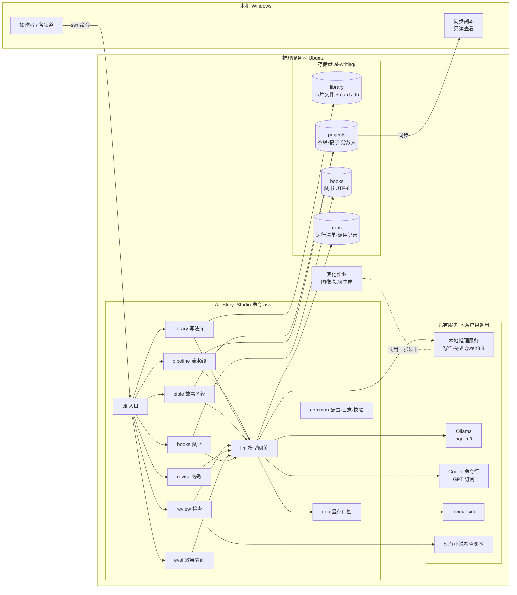

# 基本设计书

AI_Story_Studio ｜ 本地大模型剧本、小说写作系统

| 项目 | 内容 |
|---|---|
| 文档名 | 基本设计书 |
| 系统名 | AI_Story_Studio |
| 版本 | 1.3（确认版） |
| 编写日期 | 2026-11-18 |
| 编写者 | 设计担当 |
| 上游文档 | 01_要件定义书.md（1.3） |

本书定义系统「由哪些部分组成、各部分怎么接、数据长什么样、出错怎么办」。每条设计（BD）都标出对应的要件（FR、NFR），第 11 章是要件到设计的追溯表。函数级的规格在 03 详细设计书。

卡片格式（TBL-01）和拆卡方式（BD-02-10）已按《技术验证报告：藏书试拆》1.0 修订。

---

## 1. 修订履历

| 版本 | 日期 | 内容 | 担当 |
|---|---|---|---|
| 0.1 | 2026-11-18 | 初稿 | 设计担当 |
| 1.0 | 2026-11-18 | 用户确认通过（卡片格式等试拆报告出来再补）。改正 2.3 节「存储盘」「同步副本」的对应要件：原写 NFR-04（那是性能），改成存储盘对 NFR-10、NFR-13、NFR-17，同步副本对 NFR-14，两者都对要件 Q-07 | 设计担当 |
| 1.1 | 2026-11-18 | 跟进要件 1.2 的剧本线三样：节拍表（BD-02-11）、可拍性检查（BD-02-12）、TTS 围读（BD-02-13）；加模块 M-12、命令 BD-04-11～12、接口 IF-09～11、数据 TBL-21～22；追溯表加 FR-53～FR-58 | 设计担当 |
| 1.2 | 2026-11-18 | 照 PoC 报告 1.0 第 6 章（用户 11-18 确认 PQ-03）：卡片加定位栏、依据限 40 字、题材用固定词表、改编卡入库转技法卡、来源级别加藏书（TBL-01）；藏书拆卡的清洗、分章、合块、推理强度（BD-02-10）；圣经样板跨章合并（M-06）；定位回查忽略标点（M-05）。BQ-01 结案 | 设计担当 |
| 1.3 | 2026-11-18 | 跟进要件 1.3：检索改成五步（改写需求、两路、合并、AI 重挑、效果记录，BD-02-4）；受管理词表（BD-02-14）、补标签（BD-02-15）、检索考题（BD-02-16）、题材分类（BD-02-17）；加 M-13、命令 BD-04-13～16、数据 TBL-23～27；卡片加场面类型、什么时候用、效果栏；规模按 1 万张卡重估 | 设计担当 |
| 1.3 | 2026-11-18 | 用户确认 1.3（聊天），确认时改两处：藏书拆卡改成多本排队并行、登记拆完再补（BD-02-10）；卡片「题材」改名「适用题材」，加「来源题材」从 TBL-27 带入（TBL-01、BD-02-4、BD-02-15） | 设计担当 |

---

## 2. 系统整体构成（BD-01）

### 2.1 架构概要

- 系统是一组**命令行批处理程序**（Python 包 `story_studio`，命令名 `ass`），装在推理服务器上，跑完就退，不常驻（NFR-03）。
- 模型都调用服务器上**已有的服务**：
  - 本地写作模型（推理服务，OpenAI 兼容接口）；
  - 向量模型（Ollama）；
  - GPT（服务器上现有的 Codex 命令行，订阅额度）。
- 数据以**文件为主**，存在服务器的存储盘上。SQLite 只做写法库的检索索引，删了能从卡片文件重建（FR-09、NFR-10）。
- 本机（操作者的 Windows）通过 ssh 下命令，用同步把产物拉回来看（NFR-14）。

### 2.2 构成图



### 2.3 构成要素一览

| 要素 | 所在 | 说明 | 对应要件 |
|---|---|---|---|
| `ass` 命令 | 服务器 | 本系统唯一入口，子命令见第 5 章 | NFR-03、NFR-14 |
| 本地推理服务 | 服务器（已有） | 写作模型 Qwen3.8，OpenAI 兼容接口，上下文 262K，4 路并发，空闲自动卸载 | NFR-01、NFR-05 |
| Ollama | 服务器（已有） | 向量模型 bge-m3，1024 维，约 1.2GB 显存 | FR-12 |
| Codex 命令行 | 服务器（已有） | GPT 订阅，`exec --json` 输出用量；只用于拆卡片、冷读 | NFR-01、C-07 |
| 存储盘 | 服务器 | `ai-writing/` 下四个区：library、projects、books、runs | NFR-10、NFR-13、NFR-17；要件 Q-07 |
| 同步副本 | 本机 | 只读，给人看产物 | NFR-14；要件 Q-07 |
| 现有小说检查脚本 | 服务器（已有） | 复用率、密度、并段，照原样调用 | C-06 |

---

## 3. 方式设计（BD-02）

### 3.1 命令行批处理，不起服务（BD-02-1 ／ NFR-03、NFR-14）

- 每个子命令做完就退出，不监听端口。
- 长任务用 `nohup` 放后台，进度写运行清单（TBL-14），断了能续跑。
- 以后要做成别的程序能直接调用的服务，属于范围外（O-03），到时先问用户。

### 3.2 模型网关和配置切换（BD-02-2 ／ FR-50、FR-51、NFR-01、NFR-16）

- 所有模型调用都经过 `llm` 模块的统一接口 `complete(role, messages, params)` 和 `embed(texts)`。
- 每个角色用哪个模型，写在配置文件 `config/models.toml`（TBL-18）。网关读配置，派给三种后端：

| 后端 | 用在 | 怎么调 |
|---|---|---|
| `local` | 立项、圣经维护、大纲、分场、写作、检查的对照项、修改 | 本地推理服务的对话接口（IF-01） |
| `codex` | 拆卡片、冷读（默认） | Codex 命令行（IF-04） |
| `ollama` | 向量 | Ollama 向量接口（IF-03） |

- 每次调用写一行调用记录（TBL-15）：哪一步、哪个后端和模型、用时、输入输出字数和 token、结果（成功、被限流、超时、解析失败）。
- 换模型只改配置，程序不改。同一步在两个后端之间切换，输出格式一样（AC-09）。

### 3.3 数据以文件为主，SQLite 只做索引（BD-02-3 ／ FR-09、NFR-10、NFR-11）

- 卡片、圣经、稿子、分数表都是 JSON、JSONL、Markdown 文件，人能直接读、直接看改动。
- `cards.db` 由卡片文件生成，含卡片表、FTS5 trigram 全文索引、向量列。删了能重建；重建前把旧库改名留底。
- 只用 Python 标准库（含 `sqlite3`、`tomllib`）和 numpy，不新装运行依赖。测试工具 pytest 只装在开发用的虚拟环境里，不进运行环境。

### 3.4 写法库的检索方式（BD-02-4 ／ FR-11、FR-12、FR-13、FR-48、FR-59～FR-64、NFR-04、NFR-19）

1.3 改：检索分五步，前三步由代码做，第四步交模型，第五步记效果。


1. **改写需求**（FR-61）：写作这一步先让模型把场景说明改写成标准需求，栏目为阶段、体裁、题材（频道、大类、标签）、场面类型、要表现什么、有什么限制。题材和场面类型只能取受管理词表（BD-02-14）里的词。
2. **两路检索**：
   - **向量**：卡片的向量只用「什么时候用」那一句算（FR-60）；查询的向量用「要表现什么 + 场面类型」算。余弦取前 30。
   - **全文**：FTS5 trigram，在整张卡上查，bm25 取前 30。
   - **过滤**：两路都先按阶段、体裁、适用题材或来源题材（可以只要或排除）、场面类型、状态（默认只要「在用」）过滤（FR-08、FR-48）。
3. **合并**：RRF（k=60）合成一个名次，取前 30。同分按来源级别排（FR-13），再按卡片效果排（FR-64：用过多次、分数都没涨的往后放）。
4. **AI 重挑**（FR-62）：把标准需求和这 30 张卡（标题、什么时候用、做法）交给模型，挑 5–8 张，每张写一句为什么选。重挑用哪个模型写在模型配置里（角色「重挑」），默认本地写作模型，可切 GPT。专门的重排模型（bge-reranker）只作备选，装之前问用户（要件 Q-14）。
5. **效果记录**（FR-64）：稿子定稿打分后，给这份稿子用过的每张卡记一笔（TBL-26）：用了几次、分数比上一稿涨了多少。
- **规矩卡、模板卡、评分卡**仍按阶段、体裁、题材全部取出，不排名、不截断，不走上面五步（FR-11）。
- **规模**（NFR-04）：按 1 万张卡设计。本机实测 8000 张卡、1024 维：读出全部向量 0.04 秒，全算余弦加排序 0.003 秒。服务器更快，不建向量索引。
- **考题**（FR-63、NFR-19）：见 BD-02-16。

### 3.5 断点续跑（BD-02-5 ／ FR-24、NFR-07）

- 每次运行有一个运行目录 `runs/<运行号>/`，里面一份运行清单 `manifest.json`（TBL-14），记每一步的状态：未开始、进行中、完成、失败、阻塞。
- 每一步的产物先写临时文件，写完再改名成正式文件，所以不会留下写了一半的文件。
- 续跑时：完成的跳过；进行中的当成没做，重做；阻塞的检查条件满足没有（人工确认、额度恢复、显存够了）。
- 每一步是幂等的：同样的输入、同样的种子，重做得到同样的文件名，覆盖临时文件，不碰已交付的文件。

### 3.6 显存门控（BD-02-6 ／ NFR-06、C-03）

- 只有走 `local` 后端的步骤要过门控，走 `codex` 的不过（NFR-06）。
- 门控先用 `nvidia-smi` 查空闲显存（IF-05），再查推理服务现在有没有加载模型（IF-02）：
  - 写作模型已经加载：直接用；
  - 没加载，且空闲 ≥ 配置里的需要量（默认 38GB）：放行；
  - 不够：这一步记「阻塞：显存」，每隔一段时间（默认 5 分钟）再查，超过上限（默认 4 小时）就退出，交给操作者。不去停别人的作业。
- 整批跑完以后，调推理服务的卸载接口（IF-02）把显存还回去。

### 3.7 GPT 限流即停（BD-02-7 ／ FR-35、NFR-02）

- Codex 返回里有「usage limit」「rate limit」「429」「try again at」这类字样时，判为限流。
- 判为限流以后：
  - 整批停下，不重试；
  - 写一份停机说明，内容是停在哪一步、原话、预计恢复时间（能从原话里解析出来就写）；
  - 运行清单里这一步记「阻塞：额度」。
- 操作者到点后重新执行同一命令，从这一步续跑，已完成的不重复调用。

### 3.8 人工关卡（BD-02-8 ／ FR-19、FR-21、FR-23）

- 立项书、大纲、圣经改动提案这三处，系统做到「待确认」就停。
- 人确认的方式：在产物旁边放一个确认文件 `*.approved`，写上谁、什么时候确认的。系统只认这个文件，不认口头。
- 圣经改动提案里改到「锁定」事实的条目，单独列成 `locked_changes`。没有总督导转来的用户确认，这部分写不进去（FR-21）。

### 3.9 盲评（BD-02-9 ／ FR-41）

- 送评前把三方文本（改写前、改写后、藏书标杆）里的人名、地名换成代号（甲、乙、丙，A 地、B 地），截到相近长度，打乱顺序，只留编号。
- 两两比较时，先后顺序各评一次；两次结论一致才记胜负，不一致记「平」。
- 编号和来源的对照表另存，评完才打开。

### 3.10 藏书拆卡（BD-02-10 ／ FR-43～FR-49、NFR-12、NFR-17）

- 藏书先转码登记（TBL-04），再按章切开，一章一次调用，抽出卡片和圣经样板。
- **清洗**（转码后、分章前）：去掉水印行（如「★Ｄ★Ｏ★Ｓ★Ｐ★Ｙ★」「☆★……★☆」）、网站广告、作者的话和打赏名单。作者的话那一行去掉以后，只继续去掉紧跟的打赏、感谢、请假这类行，遇到第一行正文就停，因为作者的话有时放在章首；一行里有 3 个以上「网名x数字」的也当打赏名单去掉。打赏名单里是读者网名，不能进卡片。
- **分章**：认「第X回」「第X章」「Chapter X」以及前面带一两个符号的写法（如「☆、Chapter 1」）；标题后正文不到 200 字的（标题连着出现两行），并进下一章。都认不出时，按固定字数切块。
- **合块**：相邻的章合成约 2 万字一块，块边界落在章边界上；一章超过 2 万字的单独成块。每次调用有约 1.9 万 token 的固定开销，合块是为了省这笔开销（PoC 实测）。
- **排队**：多本书一起排队并行拆（用户 11-18 定 10 路，三本抽查合格后 20 路），已出结果的块跳过；登记（TBL-04）和清洗记录在拆完后补；每 5 本回报一次（FR-71）。
- **调用**：默认走 `codex` 后端，不占显卡（FR-50）；推理强度 medium（xhigh 用时 2.2 倍、输出 2 倍，质量差距不大）。每块的用量写进调用记录（FR-49、FR-51）。
- **卡片**：每块 4–10 张，种类为技法、骨架、改编，至少 1 张骨架和 1 张改编。只写做法和用自己的话概括的「依据」（不超过 40 字），不引原文。每张卡带「章」和「定位」：原文里那一处开头的 6–12 个字，回查时忽略标点和引号；回查不到的卡进待核清单（FR-06）。
- **改编卡**（FR-47）：拆卡时让模型写种类「改编」，入库时转成技法卡、阶段加「改编」，保持 FR-02 的 6 种。
- **适用题材**：拆卡模型标的是「这个写法能用在哪些题材」（PoC 发现模型就是这样理解的），所以这一栏叫「适用题材」；来源书本身的题材（「来源题材」）由分类表按书带入。PoC 和三本全本时先用 16 个词的临时表（武侠、仙侠、玄幻、历史、刑侦、悬疑、都市、校园、耽美、言情、家庭、职场、科幻、奇幻、生活、喜剧）；1.3 起改用受管理的题材词表（BD-02-14），已拆的卡由补标签程序改过来。
- **圣经样板**：每块抽人物、关系、事件、伏笔；整本拆完后跨块合并，同一个人物（按名字和别名）并成一条（M-06）。

---

### 3.11 节拍表（BD-02-11 ／ FR-53、FR-54、FR-28）

- 节拍表是骨架卡的一类，卡片多一个「子类＝节拍表」和一个「节拍」列表，每个节拍有：名称、位置（整部用百分比，短剧用秒）、要完成什么、怎么查。
- 第一批两张：整部作品的 15 个节拍（救猫咪式）；短剧节拍（前 3 秒钩子、每 30–60 秒一个爽点、每集结尾悬念）。
- 大纲角色先按立项书里的体裁和时长选一张节拍表，把节拍排进单元，再填内容。大纲的每个单元带「节拍」标记。
- 检查时由代码核对：节拍缺没缺、位置偏出多少（短剧按秒，误差上限写在节拍里）。

### 3.12 可拍性检查（BD-02-12 ／ FR-55、FR-56、C-11）

- **规则集**：从固定做法速查表导入，存成 TBL-21。每条规则有编号、类别（长距离走动、双手占用、多人同时开口、心理活动、看不见的东西，以及以后新加的）、判定方式、依据（速查表的节和行）、建议改法。
- **判定分两层**：
  1. 关键词和结构规则，由代码判。例如一镜里有两个以上说话人，就算多人同时开口；
  2. 代码判不了的，由写作模型逐镜对照规则判，并要求给出原句。
- **导入**：速查表更新后执行 `ass rules import`，生成新版本号的规则集，并输出新旧两版的差异。检查报告写明用的是哪一版。
- **打回**：查出的问题写进分数表的可拍性项（机器项），交修改模块按「重写一场」处理。

### 3.13 TTS 围读（BD-02-13 ／ FR-57、FR-58、NFR-06）

- 剧本定稿前，把每句台词交给声音频道的固定做法念一遍：IndexTTS-2.5 克隆配音，后期按「E 版」。用子进程在它自己的虚拟环境里跑（IF-09），本系统不改它的参数。
- 念之前过显存门控（BD-02-6），念完卸载。
- 挑句子：
  - **太长**：单句时长超过节奏卡的上限；
  - **拗口**：用服务器上现有的 faster-whisper 把音频转写回文字（IF-10），和原句对比，字错率超过阈值或语速明显低于全剧中位数，就算拗口；
  - **像念稿**：由写作模型按评分卡判（书面语、长定语、没有口语停顿），要求给出原句和理由。
- 结果写进 TBL-22，挑出的句子打回改写。围读音频只在服务器上留存，不当交付物。

### 3.14 受管理的词表（BD-02-14 ／ FR-59、FR-66、FR-69、FR-70、C-12）

- 两张词表：**题材**（三层：频道 → 大类 → 标签，内容照《题材分类标准》）和**场面类型**（如重逢、对峙、告白、反转、立誓、背叛、收伏笔）。存成 TBL-23。
- 每张词表有版本号；加词、改词、停用都用命令 `ass vocab add/rename/retire`，自动记改动（日期、谁、为什么），并升版本。词不删，只停用。
- 卡片、书的分类表引用词时记词表版本；词表升级后，`ass vocab check` 列出引用了停用词或旧名的卡，交补标签程序改。
- PoC 和三本全本拆卡时用的是 16 个词的临时题材表，全部改由补标签程序（BD-02-15）换成新词表。

### 3.15 补标签程序（BD-02-15 ／ FR-65、FR-69）

- 给已有卡片补「场面类型」「什么时候用」，把「适用题材」换成新词表，并从 TBL-27 带入「来源题材」。默认走 GPT（角色「补标签」），不占显卡。
- 每次送 20 张卡，只送标题、种类、做法、为什么和来源的题材分类，不送原文。
- 输出过格式校验：场面类型和题材都在词表内；「什么时候用」是一句话，30 字以内，以「当……时」或「需要……时」开头。不合格的进待核清单。
- 断点续跑和限流即停同 BD-02-5、BD-02-7；改卡走 DD 层的改卡函数，留改动记录（FR-10）。

### 3.16 检索考题（BD-02-16 ／ FR-63、NFR-19）

- 考题集 TBL-24：50 题，每题是一份标准需求（同 BD-02-4 第 1 步的栏目）和人标的「该找到的卡」编号；覆盖剧本、小说两种体裁和各阶段。
- `ass library exam`：逐题走完 BD-02-4 的 1–4 步，算前 8 张命中率（命中的应找卡数 ÷ 应找卡数），也分别记两路检索各自的命中率，看问题出在哪一步。
- 每次调整（词表、提示、权重、模型、卡片大批改动）都重考，结果写 TBL-25：日期、调整内容、命中率、和上次比。命中率降了要写原因，经确认才能采用这次调整（NFR-19）。

### 3.17 题材分类（BD-02-17 ／ FR-66～FR-68）

- **标准**：《题材分类标准》放 docs/，是题材词表的来源。
- **技能**：仓库里放一个分类技能 `skills/genre-classify/SKILL.md`（写分类步骤、判别规则、输出格式），GPT 和本地模型都按它做。
- **命令** `ass books classify <书>`：送书的开头（文案和前 3 章，最多 3 万字）和随机抽的 2 块中段，要求输出频道、大类、标签、依据（书里看得到的东西，附章号）、把握程度（高、中、低）。
- 把握程度为「低」或依据少于 2 条的，进「交用户定」清单。
- 结果写 TBL-27；藏书登记（TBL-04）的题材栏引用它。

## 4. 功能构成（BD-03）

### 4.1 分层

| 层 | 模块 | 说明 |
|---|---|---|
| 入口 | `cli` | 解析子命令，调下面的业务模块 |
| 业务 | `books`、`library`、`bible`、`pipeline`、`review`、`revise`、`eval` | 各管一块业务 |
| 基础 | `llm`、`gpu`、`common` | 模型调用、显存门控、配置、日志、文件读写、格式校验 |

业务模块之间不直接调模型，一律经 `llm`。

### 4.2 模块职责

| 模块编号 | 模块 | 职责 | 对应要件 |
|---|---|---|---|
| M-01 | `common` | 读配置（TOML）、写日志、原子写文件、JSON 格式校验、语言检查、运行清单读写 | FR-24、NFR-07、NFR-15 |
| M-02 | `llm` | 统一调用接口；三种后端；调用记录；限流判定；录制和回放（测试用） | FR-35、FR-50、FR-51、NFR-01、NFR-02、NFR-16 |
| M-03 | `gpu` | 查显存、查和卸载推理服务的模型、阻塞等待 | NFR-05、NFR-06 |
| M-04 | `books` | 藏书转码、清洗、登记、分章、合块、拆卡调度 | FR-43～FR-49、NFR-17、NFR-18 |
| M-05 | `library` | 来源清单、抽卡、校验（格式、出处、定位回查、依据长度、原文过长、集魂排除）、改编卡转技法卡、去重合并、建库、检索 | FR-01～FR-13、FR-52、NFR-04 |
| M-06 | `bible` | 新建、导入、切片、改动提案的抽取、校验、写入、快照、回滚；藏书圣经样板的跨块合并 | FR-14～FR-21、FR-25 |
| M-07 | `pipeline` | 七个角色加分镜、改编；按运行清单串起来；人工关卡 | FR-22～FR-29 |
| M-08 | `review` | 评分表；机器项、对照项、冷读；证据核对；反向对照；节拍核对；可拍性检查和规则集导入 | FR-30～FR-35、FR-38、FR-54～FR-56 |
| M-09 | `revise` | 三档修改；局部改的检查；分数升降比较和退回；交付打包 | FR-36、FR-37、FR-39 |
| M-10 | `eval` | 小说三方盲评、剧本三组对照、对比报告 | FR-40～FR-42 |
| M-11 | `cli` | 子命令入口 | NFR-14 |
| M-12 | `readthrough` | TTS 围读：调配音、回转写、量时长、挑句子 | FR-57、FR-58 |
| M-13 | `classify` | 题材分类：调分类技能给书分类，出分类表和交用户定的清单 | FR-66～FR-68 |

---

## 5. 命令设计（BD-04）

所有命令都是 `ass <子命令> [参数]`。退出码：0 成功；2 参数或格式错误；3 阻塞（等人工确认、显存或额度），可以续跑；4 校验不通过，产物进了待核清单；1 其他错误。

| 编号 | 命令 | 做什么 | 对应模块 |
|---|---|---|---|
| BD-04-1 | `ass books convert`、`ass books register` | 藏书转码、登记 | M-04 |
| BD-04-2 | `ass books split <书>` / `ass books extract <书> [--chapters 1-5]` | 分章；拆卡和圣经样板 | M-04 |
| BD-04-3 | `ass library extract` / `assemble` / `build` | 从来源清单抽卡；校验、去重、编号；建库 | M-05 |
| BD-04-4 | `ass library query "<文字>" --stage --genre --theme --k` / `ass library rules --stage --genre` | 检索技法和骨架；取规矩、模板、评分卡 | M-05 |
| BD-04-5 | `ass bible new` / `import` / `slice` / `propose` / `apply` / `rollback` | 圣经的建立、导入、切片、提案、写入、回滚 | M-06 |
| BD-04-6 | `ass run <作品> [--from <步骤>] [--unit <单元号>]` | 跑流水线，或从某一步续跑 | M-07 |
| BD-04-7 | `ass review <稿子>` / `ass review --negative-control` | 打分；反向对照 | M-08 |
| BD-04-8 | `ass revise <稿子> --level local|scene|human` | 修改；人改时登记由谁改 | M-09 |
| BD-04-9 | `ass eval novel` / `ass eval script` / `ass eval report` | 效果验证、出报告 | M-10 |
| BD-04-10 | `ass status [运行号]` | 看运行清单：每一步的状态、阻塞原因 | M-01 |
| BD-04-11 | `ass rules import <速查表>` / `ass rules diff <旧版> <新版>` | 从速查表导入可拍性规则集；对比两版 | M-08 |
| BD-04-12 | `ass readthrough <剧本>` | TTS 围读，出围读记录 | M-12 |
| BD-04-13 | `ass vocab add|rename|retire|check` | 管理词表，查引用了停用词的卡 | M-05 |
| BD-04-14 | `ass library retag [--only-missing]` | 补标签 | M-05 |
| BD-04-15 | `ass library exam [--note <调整内容>]` | 检索考试 | M-05 |
| BD-04-16 | `ass books classify <书>` / `ass books classify --all` | 题材分类 | M-13 |

---

## 6. 外部接口设计（BD-05）

| 编号 | 接口 | 方向 | 内容 | 出错时 |
|---|---|---|---|---|
| IF-01 | 本地推理服务：对话接口（`POST /v1/chat/completions`） | 本系统 → 已有服务 | 模型名、消息、温度、top_p、top_k、最大长度；写长篇时带 DRY 四个参数；关思考 `chat_template_kwargs.enable_thinking=false` | 超时或 5xx：本地后端最多重试 2 次，间隔加长；还不行，这一步记失败 |
| IF-02 | 本地推理服务：状态和卸载（`GET /running`、`/unload`） | 本系统 → 已有服务 | 看有没有加载模型；整批跑完后卸载 | 查不到就当没加载，走显存门控 |
| IF-03 | Ollama 向量接口（`POST /api/embed`） | 本系统 → 已有服务 | 模型 bge-m3，每批 32 条 | 重试 2 次；不行就退出码 1 |
| IF-04 | Codex 命令行（`codex exec --json --sandbox read-only -c model_reasoning_effort=<强度> -`） | 本系统 → 已有程序 | 提示从标准输入进；从输出的事件流里取最后一条回答和 `turn.completed.usage` | 判为限流：整批停，不重试（BD-02-7）；其他错误：这一章记失败，跳到下一章 |
| IF-05 | `nvidia-smi --query-gpu=memory.used,memory.total` | 本系统 → 系统命令 | 已用和总显存 | 读不到就当显存不够，阻塞 |
| IF-06 | 现有小说检查脚本 | 本系统 → 已有程序 | 用子进程调，读它的输出 | 脚本报错：这一项记「量不出」，不算过 |
| IF-07 | 本机和服务器同步 | 本机 ↔ 服务器 | ssh 下命令；产物用 scp 或 rsync 拉回本机；藏书原文和卡片原文不出这两台机器 | 同步失败不影响服务器上的结果 |
| IF-08 | 藏书目录 | 本系统读 | 只读原文件，转码结果另存，不改原文件 | 认不出编码：列出来，不猜（FR-43） |
| IF-09 | 配音程序（IndexTTS-2.5，声音频道的固定做法） | 本系统 → 已有程序 | 子进程调用，在它自己的虚拟环境里跑；输入一句台词和参考声，输出音频；后期按 E 版 | 失败的句子记「量不出」，不算过；整批先过显存门控 |
| IF-10 | 转写程序（faster-whisper，服务器上已有） | 本系统 → 已有程序 | 把围读音频转写回文字 | 转写失败记「量不出」 |
| IF-11 | 固定做法速查表 | 本系统读 | 读 Markdown，按节和行抽规则 | 抽不出的节列出来给人看 |

服务器地址、端口、Codex 路径都写在本地 `.env`（不进仓库），仓库里只放 `.env.example`（NFR-08）。

---

## 7. 数据设计（BD-06）

字段名用中文，和要件一致。下面是逻辑结构，字段类型和取值的细节在 03 详细设计书。

### 7.1 写法库

**TBL-01 卡片**（`library/cards/<编号>.json`，一张一个文件）

| 字段 | 说明 | 要件 |
|---|---|---|
| 编号 | 种类缩写加序号，例如 规-001、技-012 | FR-03 |
| 标题 | 20 字以内 | FR-03 |
| 种类 | 规矩、技法、节奏、骨架、模板、评分 | FR-02 |
| 阶段 | 大纲、分场、台词、分镜、正文、改编、自审，可以多选 | FR-03、FR-47 |
| 体裁 | 剧本、小说、通用 | FR-03 |
| 适用题材 | 这个写法能用在哪些题材：题材词表里的频道、大类、标签，可以多个；记词表版本 | FR-45、FR-48、FR-69 |
| 来源题材 | 藏书卡用：来源书的频道、大类、标签，从题材分类表（TBL-27）按书带入，不由拆卡模型判 | FR-45、FR-69 |
| 场面类型 | 场面类型词表里的词，可以多个 | FR-59 |
| 什么时候用 | 一句话的触发条件，30 字以内；向量检索只用这一句 | FR-60 |
| 效果 | 使用次数、用后分数变化的累计（由 TBL-26 汇总回写） | FR-64 |
| 做法 | 80–300 字，写成能照着做的话 | FR-03 |
| 为什么 | 用户原话、实测数字或拉片结论 | FR-03 |
| 正例、反例 | 自己写的句子 | FR-05 |
| 数字 | 节奏卡用 | FR-03 |
| 出处 | 来源文件和行号范围；藏书卡是书名和章号 | FR-06、NFR-13 |
| 定位 | 藏书卡用：原文那一处开头的 6–12 个字，回查时忽略标点和引号 | FR-06 |
| 依据 | 藏书卡用：自己的话概括原文那一处，不超过 40 字，不准抄原文 | FR-05、NFR-17 |
| 硬度 | 必须、建议 | FR-03 |
| 状态 | 在用、作废（附日期和原因）、待测 | FR-08 |
| 来源级别 | 用户定、实测、补充规矩、原版技能、拉片、藏书 | FR-13 |
| 关联、同义出处 | 相关卡的编号；合并进来的其他出处 | FR-07 |
| 维护者 | 哪个频道负责 | FR-10 |
| 改动记录 | 日期、改了什么、谁改的 | FR-10 |

**TBL-02 检索库**（`library/cards.db`）：`cards` 表（编号、种类、标题、阶段、体裁、题材、状态、来源级别、卡片全文 JSON、向量）和 `fts` 全文索引表（trigram）。只从 TBL-01 生成（FR-09）。

**TBL-03 来源清单**（`library/sources.json`）：每条有来源路径、只取的行段、体裁、来源级别、维护者、状态、给抽卡模型的提示。建清单时排除《集魂》资料（FR-52）。

### 7.2 藏书

**TBL-04 藏书登记**（`books/registry.json`）：书名、作者、题材、原编码、字节数、字数、章数、章长中位数、有没有影视版、转码文件位置、转码时的替换字符数（应为 0）。原文只放服务器和本机（NFR-17）。

### 7.3 故事圣经（`projects/<作品>/bible/`）

| 编号 | 文件 | 内容 | 要件 |
|---|---|---|---|
| TBL-05 | `premise.md` | 前提，用户逐条确认过的，带锁定标记 | FR-14、FR-16 |
| TBL-06 | `characters.json` | 人物，沿用《集魂》现有的 14 个字段，加锁定标记 | FR-14、FR-15 |
| TBL-07 | `world.json` | 设定：地点、物品、规则，每条带编号、出处、锁定 | FR-14 |
| TBL-08 | `threads.json` | 伏笔：编号、内容、埋在哪、状态（未收、已收、作废）、在哪收的、最晚哪里要收 | FR-14、FR-17 |
| TBL-09 | `timeline.jsonl` | 事件，每行一件：编号、单元、故事内时间、谁、做了什么、在哪、后果 | FR-14 |
| TBL-10 | `relations.jsonl` | 关系：每单元结束时每一对人的档位、数值、变化原因 | FR-14、FR-18 |
| TBL-11 | `state.jsonl` | 人物现状：每单元结束时每人的体力、精神、心情、余力、知道了什么、在哪、手里有什么 | FR-14、FR-18 |
| TBL-12 | `names.json` | 称呼：谁叫谁什么、从哪一单元起 | FR-14 |
| TBL-13 | `proposals/<单元>.json`、`snapshots/<单元>/`、`changelog.md` | 改动提案；写入前的快照；改动记录 | FR-17～FR-21 |

### 7.4 运行和记录

| 编号 | 文件 | 内容 | 要件 |
|---|---|---|---|
| TBL-14 | `runs/<运行号>/manifest.json` | 运行清单：作品、单元、每一步的状态、产物路径、开始和结束时间、阻塞原因 | FR-24、NFR-07 |
| TBL-15 | `runs/<运行号>/calls.jsonl` | 调用记录：时间、步骤、后端、模型、强度、用时、输入字数、输入 token（其中缓存）、输出 token（其中推理）、结果 | FR-51 |
| TBL-16 | `projects/<作品>/units/<单元>/score.json` | 分数表：每项的类别、满分、得分、证据（引文、位置）、理由；冷读两次的原始记录 | FR-30～FR-34 |
| TBL-17 | `projects/<作品>/units/<单元>/cards_used.json` | 这份稿子用了哪些卡（编号、在哪一步用的） | FR-39、NFR-13 |
| TBL-18 | `config/models.toml` | 模型配置：每个角色用哪个后端、模型、强度、温度、DRY、并发、显存需要量 | FR-50、NFR-16 |
| TBL-19 | `eval/<实验号>/` | 盲评：代号化后的文本、编号对照表（评完才打开）、两次顺序的评语和结论、对比报告 | FR-40～FR-42 |
| TBL-21 | `library/rules/shootability_v<版本>.json` | 可拍性规则集：版本号、导入时间、来源速查表的摘要值，每条规则的编号、类别、判定方式、依据、建议改法 | FR-55、FR-56 |
| TBL-22 | `projects/<作品>/units/<单元>/readthrough.json` | 围读记录：每句的原文、音频位置、时长、转写结果、字错率、语速、判定（太长、拗口、像念稿）和理由 | FR-57、FR-58 |
| TBL-23 | `library/vocab/themes.json`、`scenes.json` | 受管理词表：版本、词（题材按频道、大类、标签三层）、状态（在用、停用）、改动记录 | FR-59、FR-70 |
| TBL-24 | `tests/retrieval_exam/questions.json` | 检索考题：50 题的标准需求和该找到的卡编号（只放编号，不放卡片原文） | FR-63 |
| TBL-25 | `library/exam/results.jsonl` | 考试记录：日期、调整内容、总命中率、两路各自命中率、逐题结果 | FR-63、NFR-19 |
| TBL-26 | `library/usage.jsonl` | 卡片效果：每次使用一行（卡、作品、单元、稿子、用前分、用后分） | FR-64 |
| TBL-27 | `books/classify.json` | 题材分类表：书名、频道、大类、标签、依据（附章号）、把握程度、是否交用户定、用户结论 | FR-66～FR-68 |
| TBL-20 | `tests/cassettes/*.jsonl` | 录好的模型回答：请求的摘要值对应回答，结合测试回放用 | NFR-14、Q-02 |

---

## 8. 目录结构（BD-07）

### 8.1 仓库（公开）

```
AI_Story_Studio/
  README.md
  .gitignore
  .env.example            服务器地址、端口、Codex 路径的样例（不含真值）
  config/
    models.toml           模型配置的默认值
    scoring_script.toml   剧本评分表
    scoring_novel.toml    小说评分表
  src/story_studio/       M-01～M-11 各一个子包
  tests/
    unit/                 单体测试
    integration/          结合测试
    fixtures/             脱敏的示例作品、坏稿（反向对照用）
    cassettes/            录好的模型回答
  docs/                   01–09 正式文档、PoC 报告、题材分类标准
  skills/genre-classify/  题材分类技能（SKILL.md）
  scripts/
    scan_secrets.py       推送前扫描（密码、令牌、地址、长段引文、藏书文件）
```

### 8.2 服务器存储盘（不公开）

```
ai-writing/
  library/   sources.json  cards/  cards.db  cards.db.prev  report/
  books/     raw→原文件只读  utf8/  chapters/  registry.json  extract/
  projects/  <作品>/bible/  units/  deliver/
  runs/      <运行号>/manifest.json  calls.jsonl  stop_note.txt
  eval/      <实验号>/
```

本机同步副本只拉 `projects/<作品>/deliver/`、`runs/*/manifest.json`、`eval/*/report.md` 和 `library/report/`，不拉藏书原文。

---

## 9. 出错处理和断点续跑（BD-08）

| 编号 | 出错情况 | 怎么判 | 怎么办 | 运行清单记 | 退出码 |
|---|---|---|---|---|---|
| BD-08-1 | GPT 限流、额度用完 | 输出含限流字样 | 整批停，不重试，写停机说明 | 阻塞：额度 | 3 |
| BD-08-2 | 本地模型超时、5xx | 超时或状态码 | 重试 2 次，间隔加长；还不行就记失败 | 失败 | 1 |
| BD-08-3 | 显存不够 | 门控判定 | 定时再查，超上限退出；不停别人的作业 | 阻塞：显存 | 3 |
| BD-08-4 | 模型回答不是合法 JSON | 解析失败 | 同一提示重问 1 次；还不行，原文存成 `.bad.txt`，进待核清单 | 失败（这一项） | 0（整批继续） |
| BD-08-5 | 卡片出处或定位对不上 | 回查不到 | 不入库，进待核清单 | — | 4（汇总时） |
| BD-08-6 | 卡片含长段原文 | 和来源比对，连续相同超过阈值 | 不入库，进待核清单 | — | 4 |
| BD-08-7 | 圣经提案改到锁定事实 | 校验 | 拦下，等用户确认 | 阻塞：人工 | 3 |
| BD-08-8 | 等人工确认 | 没有 `.approved` | 停在这一步 | 阻塞：人工 | 3 |
| BD-08-9 | 修改后分数下降 | 新旧分数表比较 | 退回上一稿 | 完成（附说明） | 0 |
| BD-08-10 | 藏书编码认不出 | 几种编码都解不开 | 列出来，不猜 | — | 4 |
| BD-08-11 | 写了一半被中断 | 临时文件还在 | 续跑时删临时文件，重做这一步 | 进行中 → 重做 | — |

续跑都是重新执行同一条命令（或者 `ass run <作品> --from <步骤>`），系统按运行清单跳过完成的步骤。

---

## 10. 非功能设计（BD-09）

| 编号 | 项目 | 设计 | 要件 |
|---|---|---|---|
| BD-09-1 | 成本 | 网关只有三种后端，没有付费接口；`codex` 后端只给配置允许的角色用 | NFR-01、NFR-02 |
| BD-09-2 | 性能 | 按 1 万张卡设计：两路检索各一次（向量全算，本机实测 8000 张 0.04 秒读出、0.003 秒算完），目标合计 1 秒内；AI 重挑另计，60 秒内；写作模型并发上限 4，写在配置里 | NFR-04、NFR-05 |
| BD-09-3 | 资源 | 不起服务；显存门控；跑完卸载 | NFR-03、NFR-06 |
| BD-09-4 | 安全 | `.env` 不进仓库；推送前跑 `scan_secrets.py`（密码、令牌、地址、邮箱、长段引文、藏书文件名）；交付文件带版本号，不原名覆盖 | NFR-08、NFR-09、NFR-12、NFR-17 |
| BD-09-5 | 可维护 | 卡片一张一个文件；配置用 TOML；运行依赖只有标准库和 numpy | NFR-10、NFR-11、NFR-16 |
| BD-09-6 | 可追溯 | 卡片带出处；稿子带用卡清单；圣经带快照和改动记录；每次调用有记录 | NFR-13、FR-51 |
| BD-09-7 | 质量 | 单体、结合测试用 pytest 真跑，输出 JUnit XML 作为结果的唯一依据；结合测试日常用录好的回答回放，验收时真调一次 | NFR-14、Q-02 |
| BD-09-8 | 语言 | 产物和文档过语言检查 | NFR-15 |
| BD-09-9 | 数据 | 转码统一 UTF-8；藏书原文只在服务器和本机 | NFR-17、NFR-18 |

---

## 11. 要件到设计的追溯表（BD-10）

| 要件 | 设计 |
|---|---|
| FR-01 | BD-04-3、M-05、TBL-03（见各编号） |
| FR-02 | TBL-01、BD-02-10（见各编号） |
| FR-03 | TBL-01（见各编号） |
| FR-04 | M-05（抽卡提示要求中文） |
| FR-05 | TBL-01、BD-08-6（见各编号） |
| FR-06 | BD-08-5、TBL-01 出处 |
| FR-07 | M-05 去重合并、TBL-01 同义出处 |
| FR-08 | BD-02-4、TBL-01 状态 |
| FR-09 | BD-02-3、TBL-02（见各编号） |
| FR-10 | TBL-01 维护者、改动记录 |
| FR-11 | BD-02-4、BD-04-4（见各编号） |
| FR-12 | BD-02-4、BD-04-4、IF-03（见各编号） |
| FR-13 | BD-02-4（见各编号） |
| FR-14 | TBL-05～TBL-12、BD-04-5（见各编号） |
| FR-15 | M-06 导入、TBL-06 |
| FR-16 | TBL-05～TBL-07 锁定标记 |
| FR-17 | TBL-13、BD-04-5（见各编号） |
| FR-18 | M-06 校验 |
| FR-19 | BD-02-8、TBL-13（见各编号） |
| FR-20 | TBL-13 快照、BD-04-5 |
| FR-21 | BD-02-8、BD-08-7（见各编号） |
| FR-22 | M-07、BD-04-6（见各编号） |
| FR-23 | BD-02-8、BD-08-8（见各编号） |
| FR-24 | BD-02-5、TBL-14、BD-08（见各编号） |
| FR-25 | M-06 切片、BD-04-5 |
| FR-26 | M-07、M-08（见各编号） |
| FR-27 | IF-01、TBL-18（见各编号） |
| FR-28 | M-07（见各编号） |
| FR-29 | M-07（见各编号） |
| FR-30 | M-08、TBL-16、`config/scoring_*.toml`（见各编号） |
| FR-31 | TBL-16 证据、M-08 证据核对 |
| FR-32 | M-08、IF-06（见各编号） |
| FR-33 | M-08（见各编号） |
| FR-34 | M-08、IF-04（见各编号） |
| FR-35 | BD-02-7、BD-08-1（见各编号） |
| FR-36 | M-09、BD-04-8（见各编号） |
| FR-37 | M-09、BD-08-9（见各编号） |
| FR-38 | BD-04-7、`tests/fixtures` 坏稿 |
| FR-39 | M-09、TBL-17（见各编号） |
| FR-40 | M-10、BD-04-9、TBL-19（见各编号） |
| FR-41 | BD-02-9、TBL-19（见各编号） |
| FR-42 | M-10、TBL-19（见各编号） |
| FR-43 | M-04、BD-04-1、BD-08-10（见各编号） |
| FR-44 | TBL-04（见各编号） |
| FR-45 | BD-02-10、BD-04-2（见各编号） |
| FR-46 | BD-02-10、BD-04-2（见各编号） |
| FR-47 | BD-02-10（改编用技法卡、阶段标改编） |
| FR-48 | BD-02-4、TBL-01 适用题材和来源题材 |
| FR-49 | BD-02-10、TBL-15、PoC 报告 |
| FR-50 | BD-02-2、TBL-18（见各编号） |
| FR-51 | BD-02-2、TBL-15（见各编号） |
| FR-52 | TBL-03、M-05 校验 |
| FR-53 | BD-02-11、TBL-01 子类 |
| FR-54 | BD-02-11、M-07 大纲、M-08 节拍核对 |
| FR-55 | BD-02-12、M-08、TBL-21（见各编号） |
| FR-56 | BD-02-12、BD-04-11、IF-11、TBL-21（见各编号） |
| FR-57 | BD-02-13、M-12、IF-09、TBL-22（见各编号） |
| FR-58 | BD-02-13、M-12、IF-10、TBL-22（见各编号） |
| FR-59 | BD-02-4 场面类型过滤、BD-02-14 词表、TBL-23 |
| FR-60 | BD-02-4 向量只比这一句、TBL-01 什么时候用 |
| FR-61 | BD-02-4 第 1 步改写需求 |
| FR-62 | BD-02-4 第 4 步 AI 重挑、TBL-18 角色「重挑」 |
| FR-63 | BD-02-16 考题、TBL-24、TBL-25 |
| FR-64 | BD-02-4 第 5 步、TBL-26 |
| FR-65 | BD-02-15 补标签、BD-04-14 |
| FR-66 | BD-02-17、《题材分类标准》 |
| FR-67 | BD-02-17 分类技能、M-13 |
| FR-68 | BD-02-17、TBL-27 |
| FR-69 | BD-02-14、BD-02-15、TBL-01 适用题材和来源题材 |
| FR-70 | BD-02-14 词表、TBL-23、BD-04-13 |
| FR-71 | BD-02-10 拆卡流程、TBL-04 登记、M-04 |
| NFR-01 | BD-02-2、BD-09-1（见各编号） |
| NFR-02 | BD-02-7、BD-09-1（见各编号） |
| NFR-03 | BD-02-1、BD-09-3（见各编号） |
| NFR-04 | BD-02-4、BD-09-2（见各编号） |
| NFR-05 | BD-09-2、TBL-18（见各编号） |
| NFR-06 | BD-02-6 显存门控、BD-02-13 围读、BD-09-3 |
| NFR-07 | BD-02-5、BD-08（见各编号） |
| NFR-08 | IF-07、BD-09-4、`.gitignore`（见各编号） |
| NFR-09 | BD-02-8、BD-09-4（见各编号） |
| NFR-10 | BD-02-3、BD-09-5（见各编号） |
| NFR-11 | BD-02-3、BD-09-5（见各编号） |
| NFR-12 | BD-08-6、BD-09-4（见各编号） |
| NFR-13 | BD-09-6（见各编号） |
| NFR-14 | BD-09-7、TBL-20（见各编号） |
| NFR-15 | M-01、BD-09-8（见各编号） |
| NFR-16 | BD-02-2、TBL-18（见各编号） |
| NFR-17 | BD-02-10 藏书拆卡、BD-09-9 数据、IF-07 同步 |
| NFR-18 | M-04、BD-09-9（见各编号） |
| NFR-19 | BD-02-16 考题、TBL-25 记录 |

---

## 12. 待定和下一版要补的

| 编号 | 事项 | 什么时候定 |
|---|---|---|
| BQ-01 | 卡片格式（TBL-01）和藏书拆卡的提示格式、切法、推理强度 | 已结案（1.2，照 PoC 报告 1.0） |
| BQ-02 | 显存门控的默认值（需要量 38GB、每 5 分钟查一次、最多等 4 小时）是否合适 | 和模型学习频道核对后 |
| BQ-03 | 剧本、小说评分表各项的分值 | 要件 Q-06：拿两三份已有稿子试打后 |
| BQ-04 | 盲评用哪个模型：GPT 冷读，还是本地模型加 GPT 各评一次 | 03 详细设计前 |
| BQ-05 | 专门的重排模型 bge-reranker 要不要装 | 要件 Q-14：备选，要装先问用户 |
